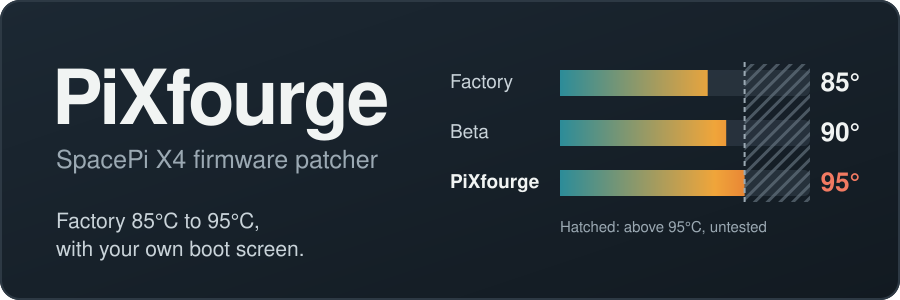
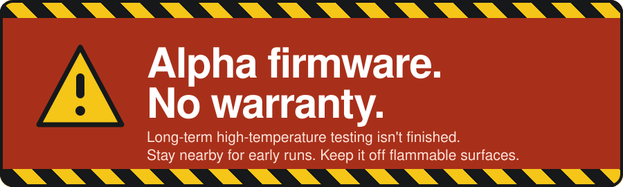

<div align="center">



### Raise your SpacePi X4's limit from the factory 85°C to 95°C.<br>No tools to install, no code to run.

**[Open the tool](https://drxen00.github.io/PiXfourge/)** &nbsp;·&nbsp; [What you need](#what-you-need) &nbsp;·&nbsp; [How to use it](#how-to-use-it) &nbsp;·&nbsp; [Check a file](#check-a-firmware-file) &nbsp;·&nbsp; [Is it safe?](#is-it-safe) &nbsp;·&nbsp; [Troubleshooting](#troubleshooting)


</div>

<br>



> [!CAUTION]
> **Please read [Is it safe?](#is-it-safe) before you flash.** The firmware's author says long-term testing at high temperature isn't finished. Stay nearby for your first runs, and keep the dryer off flammable surfaces.

<br>

Open the page, drop in a file, download a new one. Everything runs inside your browser tab, and your firmware file is never uploaded anywhere.

## What you need

| | |
| --- | --- |
| **A SpacePi X4** | The dual-chamber Creality dryer. This isn't for the X4L, which has different hardware and firmware. |
| **The beta firmware file** | `v0.2.9_3.1_cspx4.lcd` (4,161,192 bytes) from Creality. This is *not* the retail firmware on Creality's download page; that's a different build and can't be patched. If you don't have it yet, ask [@gunfuzled](https://x.com/gunfuzled) where to get it. |
| **A microSD card** | And a way to plug it into your computer. |
| **A web browser** | Chrome, Edge, Firefox, Safari, or any other modern browser. |

> [!NOTE]
> **You don't need to flash the beta first.** If your dryer is still on factory firmware (85°C maximum), that's fine. The beta file is only the starting point Pi-Xfourge patches. The file you flash replaces whatever is on the dryer now.

## How to use it

| Step | What to do |
| :---: | --- |
| **1** | **Open the tool** at the link above. |
| **2** | **Drop in the beta file.** You should get green checks. If one is red, see [Troubleshooting](#troubleshooting). |
| **3** | **Pick a boot screen.** Use the original, or choose your own image. A meter shows how much of the available space it uses. |
| **4** | **Tick the warning box, press *Build firmware*, then *Download the .lcd file*.** It takes a few seconds. |
| **5** | **Put it on the dryer.** Format a microSD card as **FAT32** (4096-byte allocation unit if it asks). Copy the new `.lcd` to the card's top-level folder. It must be the **only** `.lcd` on the card, so leave the original beta off it. Turn the dryer off, put the card in the display's slot, turn it on, and wait for the update to finish. Remove the card, and turn the dryer off and on again if it asks. |
| **6** | **Check it worked.** The About screen should say `V3.0.1_0`, and the temperature keypad should say "Input range: 45~95". |

<details>
<summary><b>Using it offline</b></summary>

<br>

Download `index.html` from this repo and open it in your browser. Everything it needs, fonts included, is inside that one file. The page makes no network requests at all.

</details>

<details>
<summary><b>Going back to stock</b></summary>

<br>

Flash a retail firmware file from [Creality](https://www.creality.com/download/creality-spacepi-x4), or the original `v0.2.9_3.1_cspx4.lcd`, the same way as above.

</details>

## Custom boot screens

Any PNG, JPG, GIF or WebP works. Pi-Xfourge resizes it to the display's 320×240 and stores it in a fixed block of unused space in the firmware: **61,056 bytes**.

- **Flat colors fit easily.** Logos, line art and text use little space. Photos, gradients and anything dithered use a lot.
- **The meter tells you.** If it goes red, the build is blocked so nothing gets overwritten. Raise **Simplify colors**, or use a simpler image.
- **Sizing:** *Fit* shows the whole image, *Fill* crops the edges, and *Use as-is* needs exactly 320×240.
- **The warning line always shows.** "ALPHA FIRMWARE: NO WARRANTY, EXPRESS OR IMPLIED" is drawn across the bottom edge for the 2 seconds the boot screen is up. In *Fit* mode the bottom 16 pixels are left clear for it.

## Check a firmware file

Not sure what a `.lcd` file is, or whether a download got damaged? Scroll to **Check any firmware file** at the bottom of the tool and drop it in. It tells you:

- whether it's the stock Creality beta, a Pi-Xfourge build, an older Creality release (by size), or something it doesn't recognize
- the temperature limits and version inside it
- whether the file's four internal checksums are intact
- its SHA-256, and whether that matches a known build

If the screen's limit and the heater controller's limit disagree, or the checksums are broken, it says **Don't flash this file**. Nothing is uploaded.

## Is it safe?

Pi-Xfourge changes two limits and nothing else important:

- **The temperature limit** goes up to 95°C, in both the display firmware and the heater-controller firmware. (Factory firmware stops at 85°C, and Creality's beta at 90°C.)
- **The boot screen and the version number** (V3.0.1_0).

According to the original project's analysis, the over-temperature and sensor protections stay switched on and are calculated from the setpoint, so they move up with it. At 95°C the heater over-temperature fault (E01) trips at 114.5°C, and the sensor-fault cutoff (E02) is fixed at 140°C. That analysis is the author's; it hasn't been independently checked here. The details are in the [technical README](docs/CFW_TECHNICAL_README.md).

What nobody has finished is long-term testing at these temperatures: wear on the chamber, the spools and the sensors. **Treat your first runs like a test.** Stay nearby and keep the dryer off flammable surfaces.

<details>
<summary><b>Verify your build</b></summary>

<br>

If you use the original boot screen, the file you download should have this SHA-256:

```
9edddccb3a0b775de31e440a51aa5b0674d9ed0941ab5d90c48d6ef38efe3054
```

That's when it's built from a beta with SHA-256 `012e12bc4cc7cd86b4f0226d3a4624b83e01a9770085327af31e2f809f91435a`. It's byte-for-byte identical to what the original command-line script produces.

</details>

## Troubleshooting

| What you see | What it means |
| --- | --- |
| "File size is … bytes. The beta is exactly 4,161,192 bytes." | That's not the beta file. Retail and older firmware can't be patched. |
| "This isn't the v0.2.9_3.1_cspx4 beta" | The file is the right size but the layout is different. Use the original beta from Creality. |
| "This file already has the 95°C patch" | You dropped in a file that's already been patched. Use the original beta. |
| "Fingerprint differs from the known beta" (amber) | The file isn't byte-for-byte the one the patch was written against, but every patch location still checks out, so it should be fine. |
| Boot screen meter is red | The image needs too much space. Raise **Simplify colors** or use a simpler image. |
| The dryer doesn't start the update | Check the card is FAT32, the file ends in `.lcd`, and it's the only `.lcd` on the card. |

## If you'd like to say thanks

<table>
<tr>
<td width="120" valign="top" align="center"></td>
<td valign="top">

The reverse-engineering, the temperature limits and the patch are all the work of **confuzled** ([@gunfuzled](https://x.com/gunfuzled) on X, [confuzled-dev](https://github.com/confuzled-dev) on GitHub). Pi-Xfourge is just a friendlier way to use it.

No pressure, but if this saved you time and you're ordering filament or parts anyway, you can support him through his referral links. He earns a commission if you buy through them.

- [Siraya Tech](https://siraya.tech/?sca_ref=9774016.2Uf9iip746&sca_source=Confuzled)
- [Polymaker](https://shop.polymaker.com/CONFUZLED)
- [VoidSpec](https://voidspec.com/aff/1/): use code **POOPMAN** for 10% off

</td>
</tr>
</table>

## Credits and notes

- The patch logic, picture format and checksums are ported from [confuzled-dev/SpacePiX4_cfw](https://github.com/confuzled-dev/SpacePiX4_cfw), and this repo keeps its full commit history. As of this writing, that project has no license file.
- Pi-Xfourge is an unofficial community tool and isn't affiliated with Creality. Provided as is, with no warranty.

<details>
<summary><b>For developers</b></summary>

<br>

| Path | What it is |
| --- | --- |
| `index.html` | The whole tool: page, styles, patcher, file checker, fonts and the default boot screen in one file. |
| `docs/CFW_TECHNICAL_README.md` | The original project README: patch table, offsets, firmware history. |
| `docs/` | The original reverse-engineering notes. |
| `scripts/build_3.0.1_0.js` | The original command-line builder. `node scripts/build_3.0.1_0.js` still works if you put the beta in `firmware/`. |
| `assets/default_splash.png` | The 320×240 default boot screen, before the warning line is added. |
| `assets/banner.svg`, `assets/warning.svg` | The graphics at the top of this README. |
| `assets/social-preview.svg`, `.png` | The 1280×640 image for the repo's social preview. |
| `tests/verify-site.cjs` | Drives `index.html` in a headless browser and checks that its output is byte-identical to the reference script's. |
| `tests/make-fixture.cjs` | Makes a synthetic stand-in for the beta so the test can run without Creality's file. It is not real firmware. |
| `tests/check-static.cjs` | Checks that the page's script parses and that the page loads nothing from outside. |

To run the tests: `npm ci && npx playwright install chromium`, then `npm test` (synthetic file, which is what CI runs) or `node tests/verify-site.cjs path/to/v0.2.9_3.1_cspx4.lcd` (the real beta, which also checks the known output fingerprint). `npm run check` runs the static checks.

</details>
